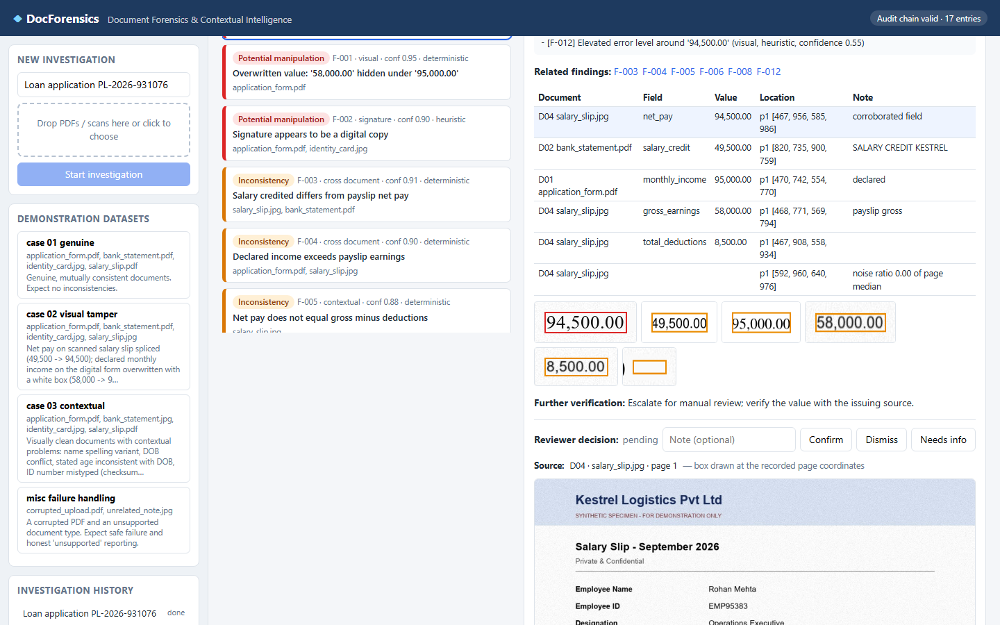
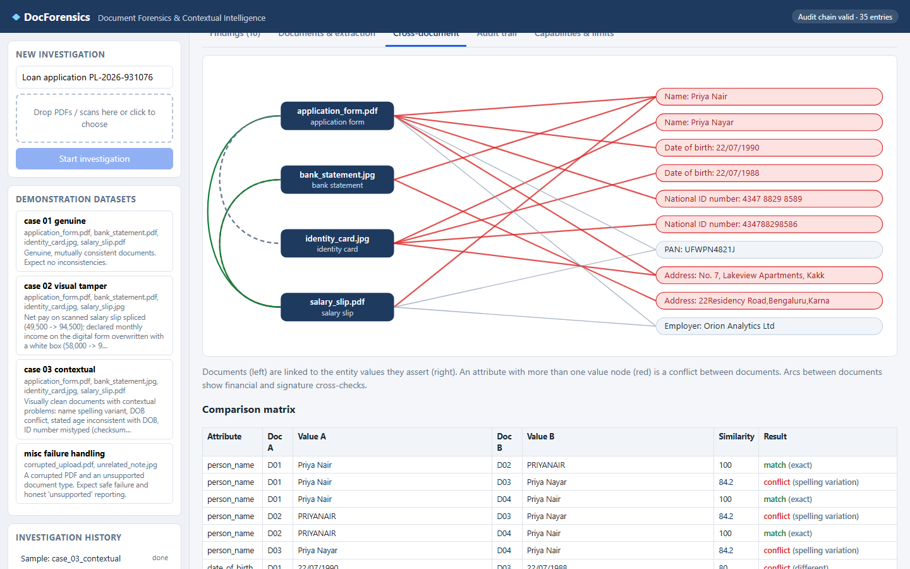
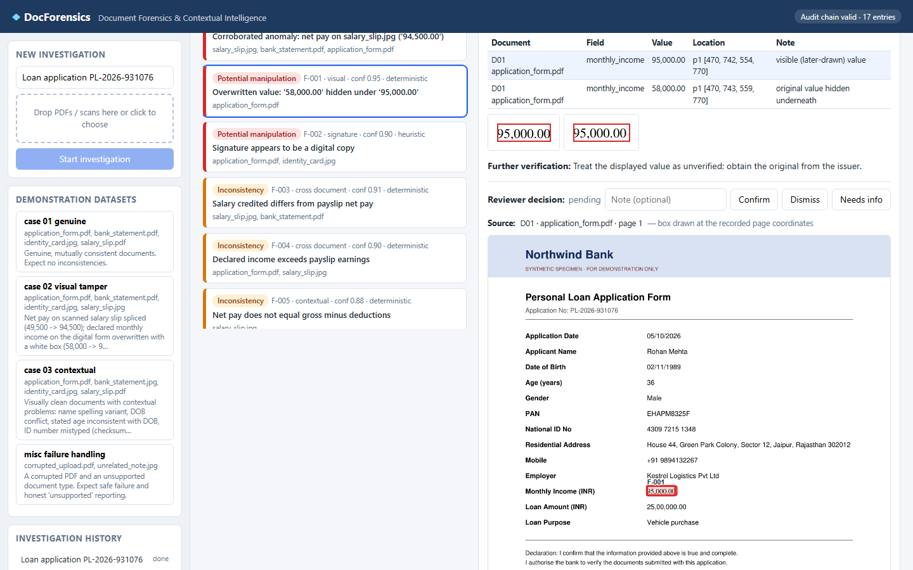
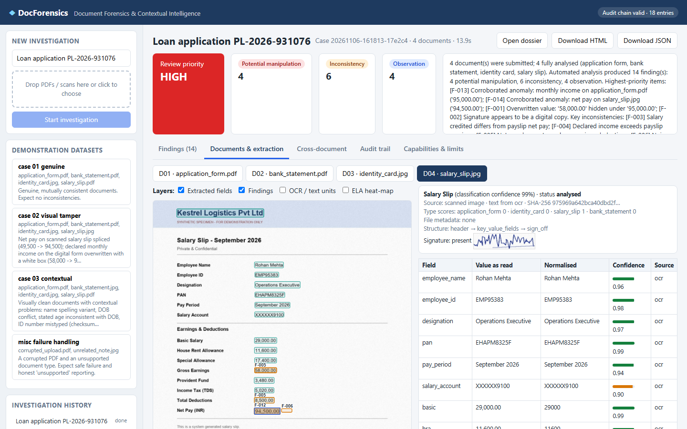

# DocForensics: AI-Powered Document Forensics & Contextual Intelligence

An investigation system that goes beyond OCR. It reads a set of related documents (loan application, identity
card, salary slip, bank statement), examines **how each file and image was produced**, checks **whether the
information inside each document is internally consistent**, and **cross-examines every document against the
others**. Every finding comes with the exact page region it refers to, an explanation, a confidence, and a clear
status: *observation*, *inconsistency* or *potential manipulation*. Nothing is ever labelled fraud. A human reviewer
decides.

**On the demonstration dataset: 17/17 planted anomalies detected, 0 false positives, genuine case clean**
([docs/EVALUATION.md](docs/EVALUATION.md)).

## Presentation & demo

- Presentation: [deliverables/DocForensics_Presentation.pptx](deliverables/DocForensics_Presentation.pptx)
- Demo video (3 min 46 s, captioned walkthrough of the real app): [deliverables/demo_video.mp4](deliverables/demo_video.mp4)
- Sample investigation dossier: [deliverables/sample_dossier_case02_visual_tamper.html](deliverables/sample_dossier_case02_visual_tamper.html)

| Corroborated anomaly with traceable evidence | Cross-document entity graph |
|---|---|
|  |  |
| **Overwritten PDF value found in the text layer** | **Structured extraction with overlays** |
|  |  |

## Quick start (Windows, Python 3.12)

```bash
powershell -ExecutionPolicy Bypass -File setup.ps1
```

```bash
powershell -ExecutionPolicy Bypass -File run.ps1
```

Open http://localhost:8000 and click a demonstration dataset (or drag in your own files).

Optional LLM-written summary: set `ANTHROPIC_API_KEY` before `run.ps1`. Without it, a deterministic template
summary is used and everything else works offline.

Linux/macOS: `python -m venv .venv && .venv/bin/pip install -r requirements.txt && .venv/bin/python -m datagen.generate && .venv/bin/python -m uvicorn app.main:app --port 8000`
(the Visual C++ runtime step in `setup.ps1` is Windows-only).

Command line:

```bash
.venv\Scripts\python scripts\run_case.py samples\case_02_visual_tamper
```

```bash
.venv\Scripts\python scripts\evaluate.py
```

## What it does

| Stage | Highlights |
|---|---|
| Submission | multi-file cases, magic-byte format check, SHA-256 of untouched originals, audit-logged |
| Classification | application form / identity card / salary slip / bank statement / unknown, with confidence |
| OCR & extraction | PDF text layer **with font names** or RapidOCR (PaddleOCR models); fragment repair; field-level confidence and bounding boxes |
| Structure | label-value pairing, multi-line values, transactions table, section hierarchy, missing/duplicate fields |
| Visual forensics | hidden text under overlays, font/size anomalies, PDF revisions & editor metadata; scanner-noise consistency, ELA, baseline/height geometry; signature presence and copy-paste detection |
| Contextual checks | ID checksum (Verhoeff), PAN/IFSC format, age vs DOB, payslip arithmetic (pinpoints the wrong figure), running balance (single-culprit), date order/period |
| Cross-document | names, DOB, ID, PAN, address (PIN-aware), employer, declared income vs payslip, net pay vs salary credit, salary account, signatures; entity graph |
| Investigation | findings linked by shared fields; **corroborated anomaly** when visual and contextual methods agree |
| Evidence & dossier | crops, annotated pages, traceable `page + bbox` for every item, HTML/print-to-PDF/JSON dossier, reviewer decisions, hash-chained audit trail |

## Repository layout

```
app/            pipeline (ingest, extract, forensics, context, crossdoc, explain, dossier, store, main)
static/         investigation console (vanilla HTML/JS, no build step)
datagen/        synthetic dataset generator (genuine + manipulated documents + ground truth)
samples/        generated demonstration dataset and ground_truth.json
scripts/        run_case.py, evaluate.py, debug helpers
docs/           ARCHITECTURE, TECHNICAL, LIMITATIONS, EVALUATION, DEMO_SCRIPT
deliverables/   sample investigation dossier
data/           runtime evidence store (created on first run)
```

## Documentation

- [Architecture](docs/ARCHITECTURE.md): diagram, components and their roles, design principles
- [Technical documentation](docs/TECHNICAL.md): every stage and forensic method, data model, API, standards, licensing
- [Limitations & assumptions](docs/LIMITATIONS.md): capability status, false-positive sources, unsupported scenarios
- [Evaluation](docs/EVALUATION.md): per-anomaly detection results


