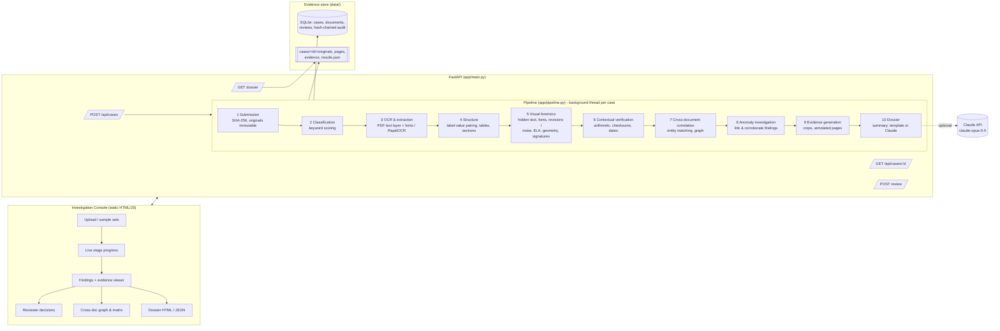

# Architecture

## Data flow and traceability

Every piece of text is a `TextUnit {text, bbox, conf, page, font}` in **page-image pixel coordinates**
(digital PDFs are rendered at 2x; scans use native pixels). Fields keep the bbox of their value and of their label.
Every finding carries `evidence[] = {doc_id, filename, page, bbox, field, value, note, crop}`. The UI and the dossier
draw boxes at exactly those coordinates, so any finding can be traced back to the original location.

## Components and their roles

| Component | Technology | Role |
|---|---|---|
| Ingestion | PyMuPDF, Pillow | format sniffing (magic bytes), rendering, metadata, EXIF, JPEG quality estimate |
| OCR | RapidOCR (PaddleOCR PP-OCR models on ONNX Runtime) | printed text + per-line confidence; fragment repair by re-recognising merged regions |
| Digital text layer | PyMuPDF `rawdict` | exact text, positions and **font names** per character |
| Classification | keyword scoring | application form / identity card / salary slip / bank statement / unknown |
| Layout & extraction | rule-based label-value pairing (rapidfuzz for tolerant label matching) | fields, multi-line values, transaction table, section hierarchy, missing/duplicate fields |
| Visual forensics | OpenCV, NumPy | ELA, noise-residual consistency, baseline/height/alignment outliers, signature localisation |
| PDF forensics | PyMuPDF | overlapping (hidden) text, opaque overlays, font/size anomalies, incremental saves, producer/creator, dates |
| Contextual checks | Python rules | Verhoeff checksum, PAN/IFSC format, age vs DOB, payslip arithmetic, running balance, date order |
| Entity matching | rapidfuzz + normalisers | names, DOB, IDs, PAN, address (PIN code aware), employer, income, salary credit, account |
| Correlation | union-find over (document, field) | links findings, raises corroborated anomalies when independent method families agree |
| Explanation | templates; optional Claude (`anthropic` SDK) | per-finding explanations; narrative summary from structured findings only |
| Evidence management | SQLite, SHA-256 | immutable originals, integrity re-check, hash-chained audit log, reviewer decisions |

## Design principles

- **Observation / inconsistency / potential manipulation** are separate statuses; nothing is labelled fraud.
- Every finding records its **basis**: `deterministic` (reproducible fact, e.g. arithmetic, hidden text layer) or
  `heuristic` (statistical signal that can false-positive, e.g. ELA).
- **OCR output is not ground truth**: low-confidence reads are called out inside explanations.
- **Human in the loop**: reviewers confirm / dismiss / request info; decisions are audit-logged and appear in the dossier.
- **The LLM never decides**: it only writes a summary from structured findings; statuses come from the checks.
- **Fail safe**: a corrupted or unsupported file is rejected or marked unsupported without stopping the case.
